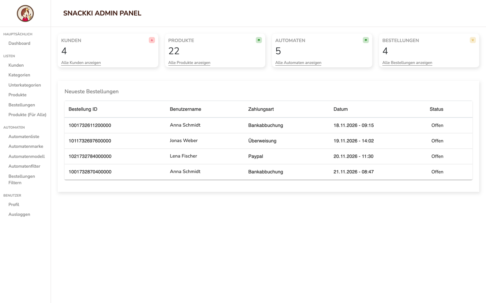
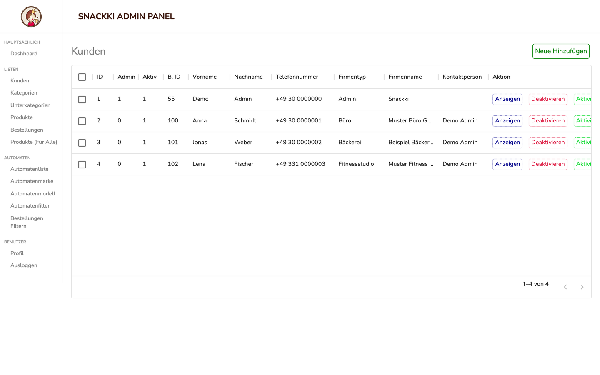
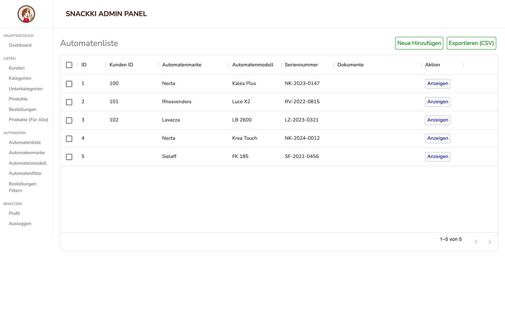
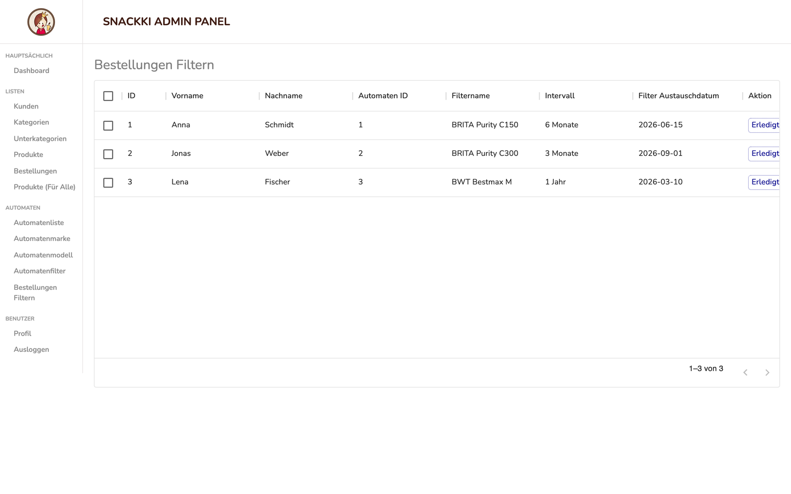
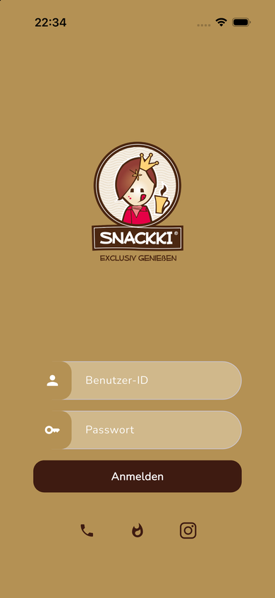
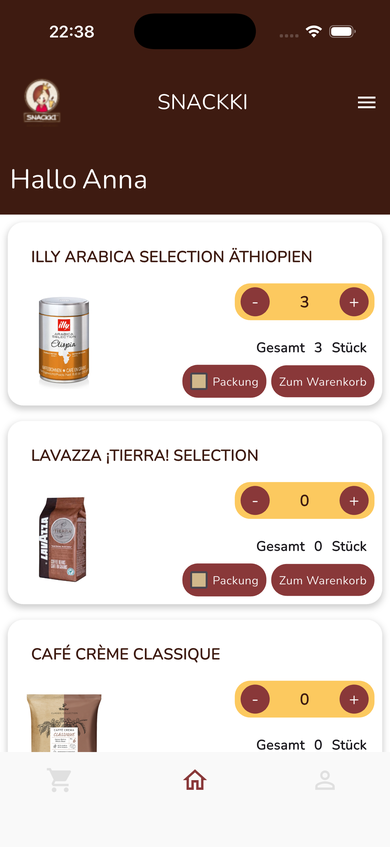
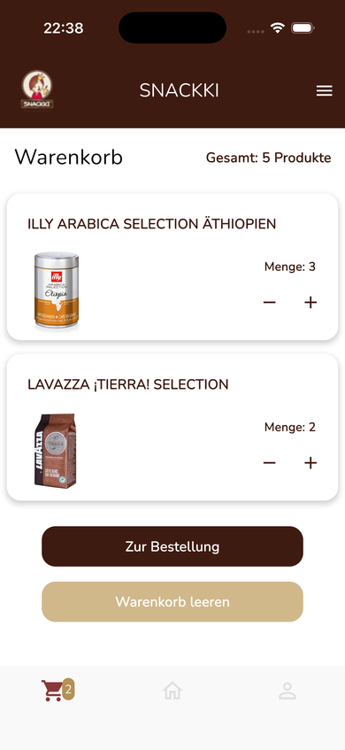
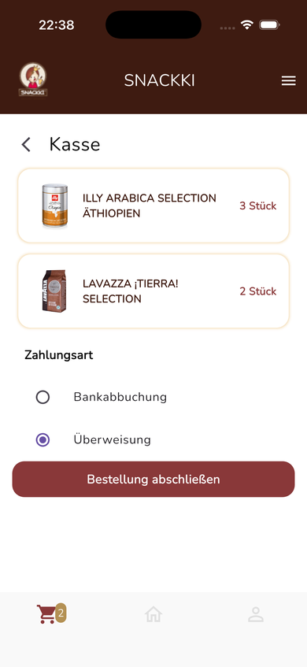

# Snackki – Vending Machine Management Platform

A full-stack platform for a vending machine company. Business customers
order coffee, tea and snacks for the machines at their location through a **mobile app**,
while the operator manages customers, machines, products, filters and orders in a
**web admin panel**. Both clients talk to a shared **REST API**.

> Developed during my internship at **Preunec GmbH** (Berlin).

## Screenshots

**Admin panel**

| Dashboard | Customers |
|---|---|
|  |  |
| **Vending machines** | **Filter changes** |
|  |  |

**Mobile app (iOS)**

| Login | Products | Basket | Checkout |
|---|---|---|---|
|  |  |  |  |

## Architecture

```
┌────────────────────┐      ┌────────────────────┐
│  Mobile app        │      │  Admin panel       │
│  Flutter (Dart)    │      │  React + Redux     │
│  customers         │      │  operators/admins  │
└─────────┬──────────┘      └─────────┬──────────┘
          │  HTTPS / JSON + JWT        │
          └────────────┬───────────────┘
                ┌──────▼───────┐
                │  REST API    │
                │  Node.js /   │
                │  Express     │
                └──────┬───────┘
                ┌──────▼───────┐
                │   MySQL      │
                └──────────────┘
```

| Folder     | What it is | Stack |
|------------|------------|-------|
| `backend/` | REST API, authentication, image uploads | Node.js, Express, MySQL (mysql2), JWT, bcrypt, multer |
| `web/`     | Admin panel (customers, machines, products, categories, orders, filter changes) | React 18, React Router 7, Redux Toolkit / RTK Query, MUI DataGrid, SCSS |
| `app/`     | Customer app (catalogue, basket, checkout, account) | Flutter, Provider, http, shared_preferences |
| `snackki.sql` | Database schema + demo data | MySQL 8 |

## Features

**Mobile app (customers)**
- Login with customer number, session persisted on the device
- Product catalogue by category, "for you" recommendations, product details
- Basket and checkout with the customer's allowed payment methods
- Change password, contact via phone / WhatsApp / Instagram

**Admin panel**
- Dashboard with key figures
- Manage customers (create, edit, deactivate, reset password), admins
- Manage vending machines with brand, model, filter and maintenance period
- Track filter changes and due dates
- Manage products, categories, subcategories and image uploads
- View and delete orders

**API / security**
- Short-lived JWT access tokens + httpOnly refresh-token cookie (admin panel)
- Role check: admin-only endpoints are protected with a `requireAdmin` middleware;
  customers can only read their own profile and only order for themselves
- Passwords hashed with bcrypt; password reset generates a random temporary password
- Parameterised SQL queries; database errors are logged server-side, not sent to clients
- CORS restricted to localhost (dev) and a configurable allow-list

## Getting started

### Requirements
- Node.js 20+ and npm
- MySQL 8
- Flutter 3.32+ (mobile app; iOS 15+ / Android)

### 1. Database
```bash
mysql -u root -e "CREATE DATABASE snackki"
mysql -u root snackki < snackki.sql
```

### 2. Backend (port 3001)
```bash
cd backend
cp .env.example .env      # fill in the values (see below)
npm install
npm run dev               # or: npm start
```
Generate the JWT secrets e.g. with
`node -e "console.log(require('crypto').randomBytes(64).toString('hex'))"`.

### 3. Admin panel (port 3000)
```bash
cd web
cp .env.example .env
npm install
npm start
```

### 4. Mobile app
```bash
cd app
cp .env.example .env      # API_URL: use your computer's LAN IP on a real phone
flutter pub get
flutter run               # or: flutter run -d chrome --web-port 8080
```

### Demo accounts
The demo database (`snackki.sql`) contains sample machines, products, orders and these accounts:

| Role | Customer number | Password | Use in |
|------|-----------------|----------|--------|
| Admin | `55` | `demo1234` | admin panel |
| Customer (office) | `100` | `kunde1234` | mobile app |
| Customer (bakery) | `101` | `kunde1234` | mobile app |
| Customer (gym) | `102` | `kunde1234` | mobile app |

The admin panel only accepts admin accounts.

Create more admins with `cd backend && npm run create-admin -- <userId> <password>`.
Customers created in the admin panel receive a random temporary password, which is
shown to the admin once.

## Environment variables

| File | Variable | Description |
|------|----------|-------------|
| `backend/.env` | `PORT` | API port (default 3001) |
| | `ACCESS_TOKEN_SECRET`, `REFRESH_TOKEN_SECRET` | JWT signing secrets |
| | `DB_HOST`, `DB_PORT`, `DB_USER`, `DB_PASSWORD`, `DB_NAME` | MySQL connection |
| | `API_TOKEN`, `CAPTCHA_SECRET_KEY`, `APPNAME` | optional |
| `web/.env` | `REACT_APP_API_URL` | API base URL |
| | `REACT_APP_API_TOKEN`, `REACT_APP_RECAPTCHA_SITE_KEY` | optional |
| `app/.env` | `API_URL` | API base URL |
| | `API_TOKEN` | optional |
| | `CONTACT_*` | company contact data shown in the app |

`.env` files are git-ignored; only the `.env.example` templates are committed.

## Project status

The project was built for a client during my internship; the client project was later
cancelled, so it is no longer maintained. This repository is a cleaned-up version for my
portfolio.
